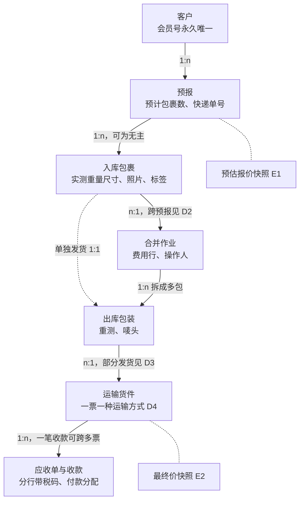

# 附件一 + 附件二：计价决策表与实体关系表

状态：**v0.1 草案，未签字**（2026-10-26）。在线可填写版本：https://claude.ai/artifact/4ZWS7mxi3DJzvpTA9h6ggu

签字后，本附件与原 PDF 冲突时以本附件为准，PDF 随之修订；之后的改动按变更处理并升版本。签字结果同步回本文件
（“业主决定”列），代码里的 `DECISION(<编号>)` 默认值随之替换。

| 版本 | 确认人（业主） | 确认人（开发） | 签字日期 |
| --- | --- | --- | --- |
| v0.1 草案 | | | |

## 附件一：计价决策表

★ = 开发方建议默认值；未签字时代码按 ★ 实现。

| 编号 | 问题 | 为什么重要 | 可选答案 | 业主决定 |
| --- | --- | --- | --- | --- |
| A1 | 海运小包“最多 100 kg、1 CBM”按什么判断 | 决定能否走小包，超限转 LCL | 实重 / 计费重；单包 / 整票（★ 整票计费重） | |
| A2 | 25 kg 单包、1.5 m 单边限制适用哪些产品 | 避免误伤 LCL、FCL 大件 | 只限小包和空运的合并资格（★）/ 所有产品的承运资格 | |
| A3 | “价格需询问”区域和超大件怎么处理 | 不能出自动报价 | 转人工（★）/ 显示区间 / 拒绝 | |
| A4 | 访客是否必须登录后才能报价 | 交接说明第 3 节写“登录后才能询价”；匿名报价少一步，但报价不保存、需要防刷 | 登录后才能报价（★，与交接说明一致）/ 匿名可报价，登录后才保存报价和预报 | |
| B1 | 空运体积重系数 | 直接决定空运价格 | 167 / 200 / 250 kg 每 m³ | |
| B2 | 空运费率 7 / 6 / 10 / 8 / 12 / 10 是每 500 g 还是每 kg | 差一倍 | 每 500 g（使用时 ×2）/ 已是每 kg | |
| B3 | 多个包装的体积重逐包算还是汇总算 | 结果不同 | 逐包后相加 / 整票汇总后计算（★） | |
| B4 | 0.5 kg 进位在哪一步 | 每包进位更贵 | 每包 / 整票（★） | |
| B5 | LCL 派送计费单位是否先舍入到 3 位小数 | 算例与直接计算差 3 分 | 是，算例正确 / 否，修正算例 | |
| B6 | 金额在哪些步骤舍入到 0.01 | 多行合计可能差 1 分 | 每行舍入后相加（★）/ 合计后舍入 | |
| C1 | 重量分档：整票按档还是超额累进 | 19.5 kg（117）比 20 kg（80）贵 | 整票按档（接受价格下降）/ 超额累进 / 整票按档但设价格下限，不低于上一档最高价（★） | |
| C2 | 清关费按什么收 | 每包、每票、每次报关结果不同 | 每票货（★）/ 每包 / 每次报关 | |
| C3 | LCL 最低派送费按什么算 | 一票多件差别大 | 每票（★）/ 每件包装 | |
| C4 | 操作费、纸箱费、拆包费的正式金额和单位 | 原型演示值 12 / 8 / 5 | 按包裹 / 按包装 / 按票，金额待填 | |
| D1 | 合并后拆成多包：每包分别计费还是整票合计计费重量 | 价格差别大 | 每包分别 / 整票合计（★） | |
| D2 | 是否允许跨预报合并 | 决定表结构 | 允许（★）/ 不允许 | |
| D3 | 是否允许部分发货 | 决定表结构和计价 | 允许 / 不允许（★ 第一期不允许） | |
| D4 | 同一批货能否分不同运输方式 | 合并资格和报价 | 允许拆成两票 / 不允许 | |
| D5 | 客户拒绝最终价时已发生的费用谁承担 | 退回和收费 | 客户 / 公司 / 协商 | |
| D6 | 一张快递单对应多个实体包裹（一单多箱、主子单）是否允许 | 入库防重规则 | 允许，按件序号区分（★）/ 不允许 | |
| E1 | 预估价锁哪个费率版本、有效期多久 | 费率改了旧预估还算不算 | 锁预报时版本，有效 N 天（★ 14 天） | |
| E2 | 最终价用哪个费率版本 | 货到仓时费率可能已变 | 入库时生效版本（★）/ 预报时 / 客户确认时 | |
| E3 | “最终价”成立条件和之后仍可加收的项目 | 客诉和拒付 | 清单：查验、检疫、住宅派送、仓储、危险品、超大件 | |
| E4 | 最终价之后加收是否需要客户再次同意 | 放货和收款流程 | 需要（★）/ 只通知 | |
| E5 | 免费仓储期和仓储费 | 放货条件和最终价 | 天数和费率待填 | |
| F1 | 每类费用的税码和税率 | 国际运费零税率有条件 | 会计师出逐项表 | |
| F2 | 进口 GST 和关税怎样告知客户 | 不写进引擎 | 固定文案 + 海关链接（★） | |
| F3 | FCL 的 USD 和 NZD 怎么开票 | 汇率争议 | 两张发票（★）/ 一张按付款时锁定汇率 | |
| G1 | FCL 海运费和本地费用的利润加价 | 现在按成本价 | 百分比 / 固定金额 / 暂不加 | |
| G2 | 税号超过 5 个后每多一个的报关费 | 报价要标明 | 金额待填 | |
| G3 | FCL 港口运价表谁更新、多久更新；过期后是否停止出数 | 当前表只到 2026-10-14，已过期；纳皮尔 TAC 11–12 月的数值也没给出 | 业主 / 开发 / 货代；过期停止出数转人工（★） | |

## 附件二：实体关系与状态转换

交接说明 8.1 把包裹直接挂在货件下；这里拆成 预报 → 入库包裹 → 合并作业 → 出库包装 → 运输货件，
原包裹到新包装的对应关系始终保留。D2–D4 决定其中三条关系能否成立。

状态线（包裹、合并作业、运输货件、付款）和客户 7 步进度映射见 `../design/03-state-machines.md`；
其中“能否回退”一列需要业主逐行确认。
