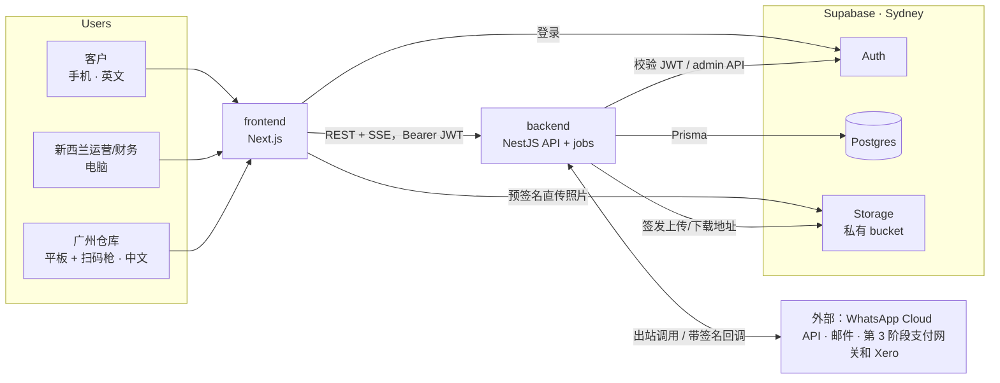

# 01 总体架构与部署

所有业务逻辑在 NestJS 后端；Supabase 提供 Postgres、Auth 和 Storage；Next.js 前端只负责界面，通过后端 API 读写数据。
前端不直接查询数据库表。



## 关键决定

| 决定 | 选择 | 理由 |
| --- | --- | --- |
| 数据访问 | 只经过 NestJS；前端不用 supabase-js 查表 | 价格逻辑、权限、字段脱敏集中在一处，可测试 |
| RLS | 所有 `public` 表开启 RLS 且不为 `anon`/`authenticated` 建策略（默认拒绝） | 防止 anon key 被拿去直接读表 |
| 表结构所有者 | Prisma migrate 唯一负责；RLS、触发器、权限写在 Prisma 的 SQL 迁移里 | 避免 Supabase CLI 与 Prisma 两边改表 |
| 连接 | `DATABASE_URL` 走 Supavisor 池（6543，`pgbouncer=true`）；`DIRECT_URL` 直连（5432）用于迁移、LISTEN、pg-boss | 池连接不支持 LISTEN 和会话级特性 |
| 实时 | 后端 SSE；进程间用 Postgres `LISTEN/NOTIFY` | 不引入 Redis；不依赖 Supabase Realtime 的权限配置 |
| 任务队列 | pg-boss（存在同一个 Postgres） | 通知重试、定时任务、对账，不引入 Redis |
| 文件 | Supabase Storage 私有 bucket；后端签发上传/下载 URL | 前端直传，后端控制权限 |
| 价格 | 后端 `pricing/engine` 纯函数 | 交接说明要求浏览器里不得有价格逻辑 |

## 部署（初始建议，可在 ADR 中调整）

- Supabase 项目：悉尼区域；`dev`、`staging`、`prod` 三个项目分开。
- backend：Docker 镜像，部署在悉尼区域的容器服务（如 AWS App Runner / ECS Fargate）；至少 2 个实例；
  pg-boss worker 跑在同一镜像的独立进程（`node dist/worker.js`）。
- frontend：Docker 镜像同区域部署，或 Vercel（悉尼函数区域）；自有域名。
- 广州仓库经 AWS 专线访问（业主确认）。第 0 周在仓库实测登录、API、照片上传、SSE 断线重连一次，记录到 ADR。
- 监控：Sentry（前后端）、健康检查 `/health`、错误告警 5 分钟内送达负责人；日志用 pino 结构化输出。

## 环境变量（backend）

```
DATABASE_URL=            # Supavisor pooled, ?pgbouncer=true&connection_limit=1
DIRECT_URL=              # direct 5432, migrations + LISTEN + pg-boss
SUPABASE_URL=
SUPABASE_SERVICE_ROLE_KEY=
SUPABASE_JWKS_URL=       # ${SUPABASE_URL}/auth/v1/.well-known/jwks.json
STORAGE_BUCKET_PHOTOS=parcel-photos
STORAGE_BUCKET_DOCS=documents
WHATSAPP_TOKEN= WHATSAPP_PHONE_NUMBER_ID= WHATSAPP_APP_SECRET= WHATSAPP_VERIFY_TOKEN=
EMAIL_PROVIDER_API_KEY= EMAIL_FROM=
APP_BASE_URL= STAFF_BASE_URL=
SENTRY_DSN=
```

## 环境变量（frontend）

```
NEXT_PUBLIC_SUPABASE_URL=
NEXT_PUBLIC_SUPABASE_ANON_KEY=
NEXT_PUBLIC_API_BASE_URL=
SENTRY_DSN=
```
